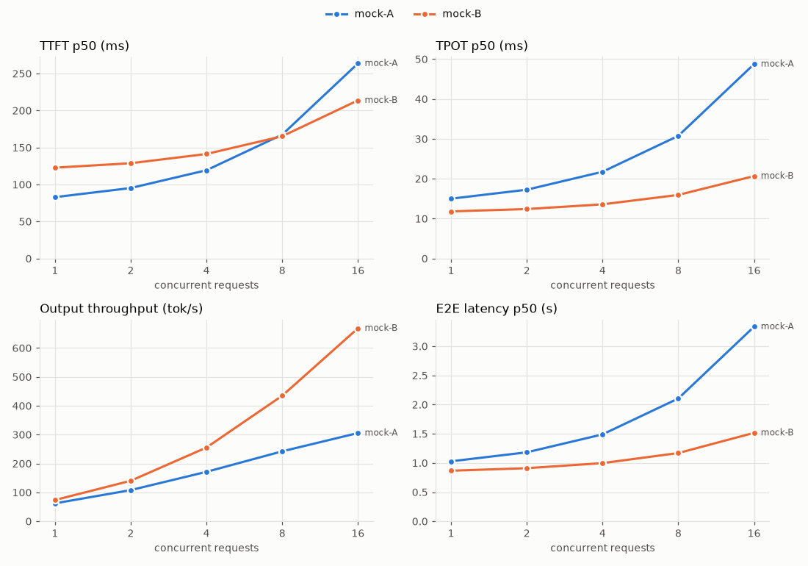

# servebench

[](https://github.com/Prajwal7-2002/servebench/actions/workflows/ci.yml)
[](LICENSE)


Load-test any OpenAI-compatible LLM endpoint (Ollama, llama.cpp server, vLLM, SGLang, your
own engine) and get the numbers that matter for serving: **TTFT, TPOT, inter-token latency,
throughput and goodput**, at p50/p90/p99, over a sweep of load levels, with charts and
side-by-side comparison of runs.

No GPU or engine install is needed on the client: it is one async Python process talking HTTP.

## Quickstart

Uses [uv](https://docs.astral.sh/uv/). PyPI release coming; for now, from a clone:

```bash
uv tool install --from . "servebench[fake]"   # puts `servebench` on your PATH

# try it with no model at all: a fake server with known timings
servebench fake-server --ttft-ms 80 --itl-ms 15 --slowdown 0.15 &
servebench run --url http://127.0.0.1:8000/v1 --model fake-model \
    --concurrency 1,2,4,8,16 --output-len 64 --out runs/fake.json

# a real server, e.g. Ollama
servebench run --url http://localhost:11434/v1 --model qwen2.5:0.5b \
    --concurrency 1,2,4,8 --input-len 256 --output-len 128 --out runs/ollama.json

# compare runs
servebench report runs/ollama.json runs/llamacpp.json --out report.html
```

## Results

Real runs (Ollama and llama.cpp on a laptop CPU, vLLM on a free Kaggle T4, all with
Qwen2.5-0.5B) are next on the list (milestone M4). Until then, here is the report for two
fake servers with known behaviour, which is also how the metrics are tested:



| fake-A load | req/s | out tok/s | TTFT p50 (ms) | TPOT p50 (ms) | E2E p50 (s) |
|---|---|---|---|---|---|
| c=1 | 0.97 | 62.1 | 84 | 15 | 1.03 |
| c=4 | 2.68 | 171.5 | 119 | 22 | 1.49 |
| c=16 | 4.79 | 306.3 | 263 | 49 | 3.34 |

fake-A was set to TTFT 80 ms, 15 ms per token, slowing down 15% per extra request in flight,
so at c=16 TPOT should be 15 × (1 + 0.15 × 15) ≈ 49 ms, which is what was measured.
Full report: [examples/report.md](examples/report.md).

## Metrics

| Metric | Meaning |
|---|---|
| TTFT | Request sent → first streamed chunk with non-empty content (role-only and empty chunks don't count) |
| TPOT | (E2E − TTFT) / (output tokens − 1) |
| ITL | Gaps between consecutive content chunks. Some servers put several tokens in one chunk; the report shows `tok/chunk` so you can tell |
| E2E | Request sent → end of stream |
| req/s, out tok/s | Completed requests and output tokens per second of wall time for the level |
| Goodput | Requests/s that meet the SLOs (default TTFT < 500 ms and TPOT < 50 ms; change with `--slo-ttft-ms`/`--slo-tpot-ms`, also at report time) |
| Errors | Failed requests grouped by kind (`HTTP 500`, `timeout`, `ConnectError`, ...) |

Token counts come from the server's `usage` (requested with `stream_options.include_usage`).
If the server sends none, servebench counts with a Hugging Face tokenizer if you pass
`--tokenizer Qwen/Qwen2.5-0.5B-Instruct` (install the `hf` extra: `servebench[hf]`), or falls back to
counting chunks. Every request records which source was used, and the report warns about
chunk counts.

## Load modes

- **Concurrency sweep** (`--concurrency 1,2,4,8`, closed loop): exactly N requests in flight
  until the level's requests are done. Shows how latency degrades as load grows.
- **Request rate** (`--rate 0.5,1,2,inf`, open loop): Poisson arrivals at R req/s, whether or
  not earlier requests finished; `inf` sends everything at once, `--max-concurrency` caps it.
  This is how you find the point where a server falls over.

Each level gets `--num-requests` requests (default `max(16, 4N)` for concurrency, 64 for
rate). Two warm-up requests run first and are not measured. Everything is seeded.

## Prompts

- `--prompts synthetic` (default): `--input-len` tokens of random common words, a different
  prompt per request so prefix caches cannot reuse one prompt's work for the next.
  `--ignore-eos` (on by default) asks the server to always generate `--output-len` tokens;
  vLLM, SGLang and llama.cpp honour it, and servers that don't know it ignore it, so check
  `out tok/s` against `--output-len` when comparing.
- `--prompts dolly`: real prompts from
  [databricks-dolly-15k](https://huggingface.co/datasets/databricks/databricks-dolly-15k)
  (CC BY-SA 3.0, © Databricks), downloaded once (12.8 MB) into `~/.cache/servebench` (set
  `SERVEBENCH_CACHE` to move it). Not bundled with this repo. `--input-len` caps the prompt
  length in words.
- `--prompts my_prompts.jsonl` (`{"prompt": ...}` per line) or a `.txt` file, one prompt per
  line.

## How it works

```
prompts.py ──► load.py ─────────────► client.py ──HTTP/SSE──► server
 synthetic      concurrency workers    one streaming request,
 dolly          or Poisson arrivals    perf_counter per chunk
 file           + event-loop lag check
                     │
                     ▼
               metrics.py ──► run.json ──► report.py
               percentiles,               terminal table,
               goodput                    PNG charts, MD / HTML
```

- One `asyncio` process with `httpx`. Timings use `time.perf_counter()`.
- Every request's chunk arrival times are saved in `run.json`, so reports can be recomputed
  (for example with different SLOs) without rerunning anything.
- The client checks itself: a background task measures how long a ready callback waits for
  the event loop. If the p99 is above 10 ms, the report warns that the client, not the server,
  may be the bottleneck.
- `servebench fake-server` is a FastAPI server that streams with known TTFT, ITL, tokens per
  chunk and slowdown under load. The tests check every metric against it.

## Limitations

- One client process. Fine for the hundreds of concurrent requests a single GPU serves; not
  for thousands. The lag check tells you when it is struggling.
- The first requests of each level include opening TCP connections, as a real client would.
- TPOT and ITL are only as good as the token counts: without `usage` or `--tokenizer`, a
  server that sends several tokens per chunk will look slower per token than it is.
- Measures what the client sees over HTTP, including network and serialization, not the
  engine's internal timings.
- Text endpoints only (chat and completions); no images, tool calls or embeddings.

## Related tools

servebench does not try to replace the bigger tools; use them if they fit:
[vLLM's `vllm bench serve`](https://docs.vllm.ai/),
[NVIDIA GenAI-Perf](https://github.com/triton-inference-server/perf_analyzer),
[guidellm](https://github.com/vllm-project/guidellm),
[LLMPerf](https://github.com/ray-project/llmperf).
servebench is a small install that works against any engine, makes clean multi-run
comparisons, and is used to measure the rest of this series of projects on free hardware.

## Development

```bash
uv sync                      # creates .venv and installs the package + dev tools
uv run ruff check src tests
uv run pytest -q
```

No need to create or activate a virtualenv yourself; `uv run` uses the project's `.venv`.

## License

Apache 2.0. The dolly-15k dataset, if you use it, is CC BY-SA 3.0 and is downloaded from
Hugging Face at runtime, not distributed here.
