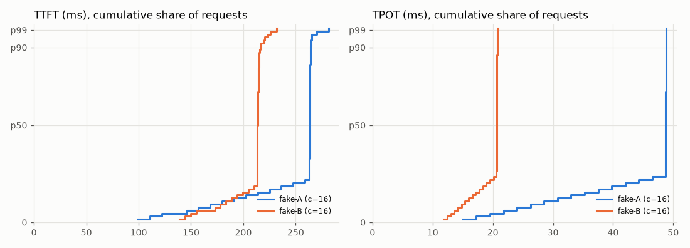

# servebench report

## fake-A

| | |
|---|---|
| model | fake-model |
| url | http://127.0.0.1:8123/v1 |
| endpoint | chat |
| prompts | synthetic, input ~256 tok, output 64 tok |
| ignore_eos | True |
| seed | 0 |
| client | Windows 11, Python 3.12.10, AMD64 Family 25 Model 68 Stepping 1, AuthenticAMD, 12 logical CPUs |
| when | 2026-10-16T10:53:13+00:00 |
| notes | fake server: ttft 80ms itl 15ms slowdown 0.15 |

| load | ok/fail | req/s | out tok/s | TTFT p50 | TTFT p99 | TPOT p50 | TPOT p99 | ITL p50 | E2E p50 (s) | goodput | tok/chunk |
|---|---|---|---|---|---|---|---|---|---|---|---|
| c=1 | 16/0 | 0.97 | 62.1 | 84 | 85 | 15 | 15 | 15 | 1.03 | 0.97 | 1.00 |
| c=2 | 16/0 | 1.69 | 108.1 | 95 | 98 | 17 | 17 | 17 | 1.18 | 1.69 | 1.00 |
| c=4 | 16/0 | 2.68 | 171.5 | 119 | 125 | 22 | 22 | 22 | 1.49 | 2.68 | 1.00 |
| c=8 | 32/0 | 3.79 | 242.6 | 167 | 177 | 31 | 31 | 31 | 2.11 | 3.79 | 1.00 |
| c=16 | 64/0 | 4.79 | 306.3 | 263 | 275 | 49 | 49 | 49 | 3.34 | 4.79 | 1.00 |

Latencies in ms unless noted. Goodput = req/s meeting TTFT < 500 ms and TPOT < 50 ms.

## fake-B

| | |
|---|---|
| model | fake-model |
| url | http://127.0.0.1:8124/v1 |
| endpoint | chat |
| prompts | synthetic, input ~256 tok, output 64 tok |
| ignore_eos | True |
| seed | 0 |
| client | Windows 11, Python 3.12.10, AMD64 Family 25 Model 68 Stepping 1, AuthenticAMD, 12 logical CPUs |
| when | 2026-10-16T10:54:12+00:00 |
| notes | fake server: ttft 120ms itl 12ms 2 tok/chunk slowdown 0.05 |

| load | ok/fail | req/s | out tok/s | TTFT p50 | TTFT p99 | TPOT p50 | TPOT p99 | ITL p50 | E2E p50 (s) | goodput | tok/chunk |
|---|---|---|---|---|---|---|---|---|---|---|---|
| c=1 | 16/0 | 1.15 | 73.6 | 124 | 125 | 12 | 12 | 24 | 0.87 | 1.15 | 2.00 |
| c=2 | 16/0 | 2.19 | 140.3 | 130 | 132 | 12 | 12 | 25 | 0.91 | 2.19 | 2.00 |
| c=4 | 16/0 | 4.00 | 256.0 | 141 | 147 | 14 | 14 | 28 | 1.00 | 4.00 | 2.00 |
| c=8 | 32/0 | 6.81 | 435.8 | 165 | 174 | 16 | 16 | 32 | 1.17 | 6.81 | 2.00 |
| c=16 | 64/0 | 10.50 | 672.1 | 214 | 228 | 21 | 21 | 42 | 1.52 | 10.50 | 2.00 |

Latencies in ms unless noted. Goodput = req/s meeting TTFT < 500 ms and TPOT < 50 ms.
