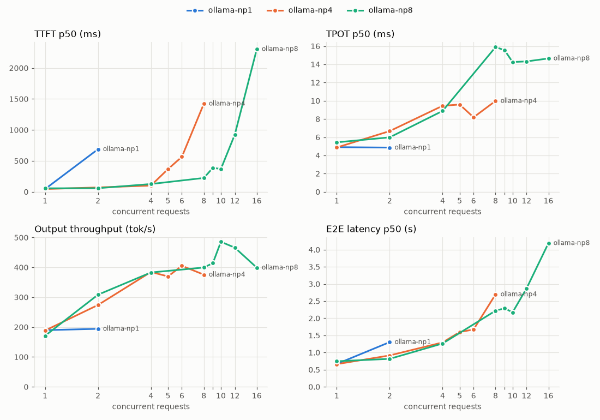
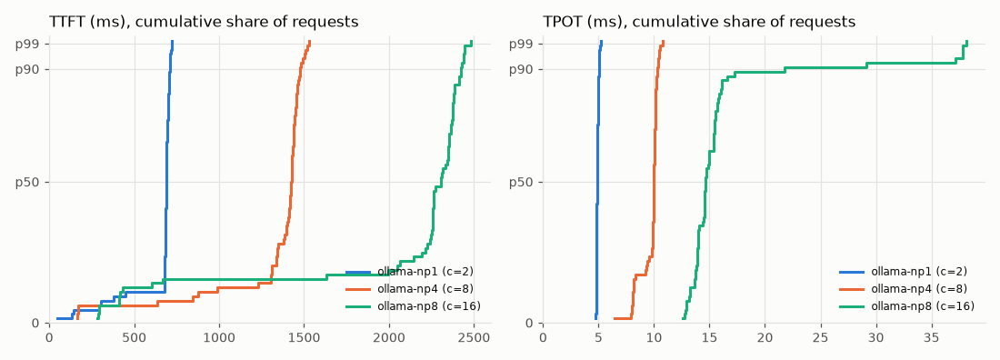

# servebench report

## ollama-np1

**Capacity: 1 concurrent request. At 1, 100% met the SLO; at 2, only 11%. SLO: TTFT < 500 ms and TPOT < 50 ms for 90% of requests.**

| | |
|---|---|
| model | qwen2.5:0.5b |
| url | http://127.0.0.1:11434/v1 |
| endpoint | chat |
| prompts | synthetic, input ~256 tok, output 128 tok |
| ignore_eos | True |
| seed | 0 |
| client | Windows 11, Python 3.12.10, AMD64 Family 25 Model 68 Stepping 1, AuthenticAMD, 12 logical CPUs |
| when | 2026-10-16T12:41:08+00:00 |
| notes | Ollama 0.35.1, qwen2.5:0.5b Q4_K_M, RTX 3050 6GB laptop, OLLAMA_NUM_PARALLEL=1 |

| load | ok/fail | req/s | out tok/s | TTFT p50 | TTFT p99 | TPOT p50 | TPOT p99 | ITL p50 | E2E p50 (s) | goodput | tok/chunk | in SLO |
|---|---|---|---|---|---|---|---|---|---|---|---|---|
| c=1 | 64/0 | 1.51 | 189.9 | 45 | 59 | 4.9 | 5.2 | 4.9 | 0.67 | 1.51 | 1.00 | 100% |
| c=2 | 64/0 | 1.62 | 194.2 | 688 | 720 | 4.9 | 5.1 | 4.8 | 1.30 | 0.18 | 1.00 | 11% |

Latencies in ms unless noted. Goodput = req/s meeting TTFT < 500 ms and TPOT < 50 ms.

## ollama-np4

**Capacity: 4 concurrent requests. At 4, 100% met the SLO; at 5, only 72%. SLO: TTFT < 500 ms and TPOT < 50 ms for 90% of requests.**

| | |
|---|---|
| model | qwen2.5:0.5b |
| url | http://127.0.0.1:11434/v1 |
| endpoint | chat |
| prompts | synthetic, input ~256 tok, output 128 tok |
| ignore_eos | True |
| seed | 0 |
| client | Windows 11, Python 3.12.10, AMD64 Family 25 Model 68 Stepping 1, AuthenticAMD, 12 logical CPUs |
| when | 2026-10-16T12:42:45+00:00 |
| notes | Ollama 0.35.1, qwen2.5:0.5b Q4_K_M, RTX 3050 6GB laptop, OLLAMA_NUM_PARALLEL=4 |

| load | ok/fail | req/s | out tok/s | TTFT p50 | TTFT p99 | TPOT p50 | TPOT p99 | ITL p50 | E2E p50 (s) | goodput | tok/chunk | in SLO |
|---|---|---|---|---|---|---|---|---|---|---|---|---|
| c=1 | 64/0 | 1.50 | 188.5 | 45 | 57 | 4.9 | 5.6 | 4.8 | 0.66 | 1.50 | 1.00 | 100% |
| c=2 | 64/0 | 2.27 | 274.0 | 71 | 98 | 6.7 | 7.6 | 6.1 | 0.92 | 2.27 | 1.00 | 100% |
| c=4 | 64/0 | 3.16 | 384.6 | 101 | 197 | 9.4 | 11 | 8.1 | 1.30 | 3.16 | 1.00 | 100% |
| c=5 | 64/0 | 3.11 | 369.8 | 367 | 943 | 9.6 | 12 | 7.9 | 1.60 | 2.23 | 1.00 | 72% |
| c=6 | 64/0 | 3.30 | 405.2 | 566 | 1360 | 8.2 | 11 | 8.0 | 1.67 | 1.55 | 1.00 | 47% |
| c=8 | 64/0 | 3.06 | 375.7 | 1424 | 1525 | 10.0 | 11 | 8.2 | 2.70 | 0.19 | 1.00 | 6% |

Latencies in ms unless noted. Goodput = req/s meeting TTFT < 500 ms and TPOT < 50 ms.

## ollama-np8

**Capacity: 8 concurrent requests. At 8, 100% met the SLO; at 9, only 64%. SLO: TTFT < 500 ms and TPOT < 50 ms for 90% of requests.**

| | |
|---|---|
| model | qwen2.5:0.5b |
| url | http://127.0.0.1:11434/v1 |
| endpoint | chat |
| prompts | synthetic, input ~256 tok, output 128 tok |
| ignore_eos | True |
| seed | 0 |
| client | Windows 11, Python 3.12.10, AMD64 Family 25 Model 68 Stepping 1, AuthenticAMD, 12 logical CPUs |
| when | 2026-10-16T12:45:32+00:00 |
| notes | Ollama 0.35.1, qwen2.5:0.5b Q4_K_M, RTX 3050 6GB laptop, OLLAMA_NUM_PARALLEL=8 |

| load | ok/fail | req/s | out tok/s | TTFT p50 | TTFT p99 | TPOT p50 | TPOT p99 | ITL p50 | E2E p50 (s) | goodput | tok/chunk | in SLO |
|---|---|---|---|---|---|---|---|---|---|---|---|---|
| c=1 | 64/0 | 1.36 | 170.9 | 57 | 62 | 5.4 | 5.8 | 5.4 | 0.75 | 1.36 | 1.00 | 100% |
| c=2 | 64/0 | 2.56 | 308.5 | 59 | 86 | 6.0 | 6.6 | 5.5 | 0.82 | 2.56 | 1.00 | 100% |
| c=4 | 64/0 | 3.07 | 383.0 | 126 | 173 | 8.9 | 16 | 8.0 | 1.26 | 3.07 | 1.00 | 100% |
| c=8 | 64/0 | 3.30 | 399.6 | 224 | 386 | 16 | 30 | 13 | 2.22 | 3.30 | 1.00 | 100% |
| c=9 | 64/0 | 3.39 | 414.3 | 388 | 1341 | 16 | 25 | 13 | 2.29 | 2.17 | 1.00 | 64% |
| c=10 | 64/0 | 3.91 | 485.7 | 369 | 1978 | 14 | 18 | 12 | 2.17 | 2.26 | 1.00 | 58% |
| c=12 | 64/0 | 3.75 | 466.1 | 926 | 2419 | 14 | 18 | 12 | 2.87 | 1.29 | 1.00 | 34% |
| c=16 | 64/0 | 3.24 | 399.2 | 2306 | 2459 | 15 | 38 | 13 | 4.19 | 0.41 | 1.00 | 12% |

Latencies in ms unless noted. Goodput = req/s meeting TTFT < 500 ms and TPOT < 50 ms.
